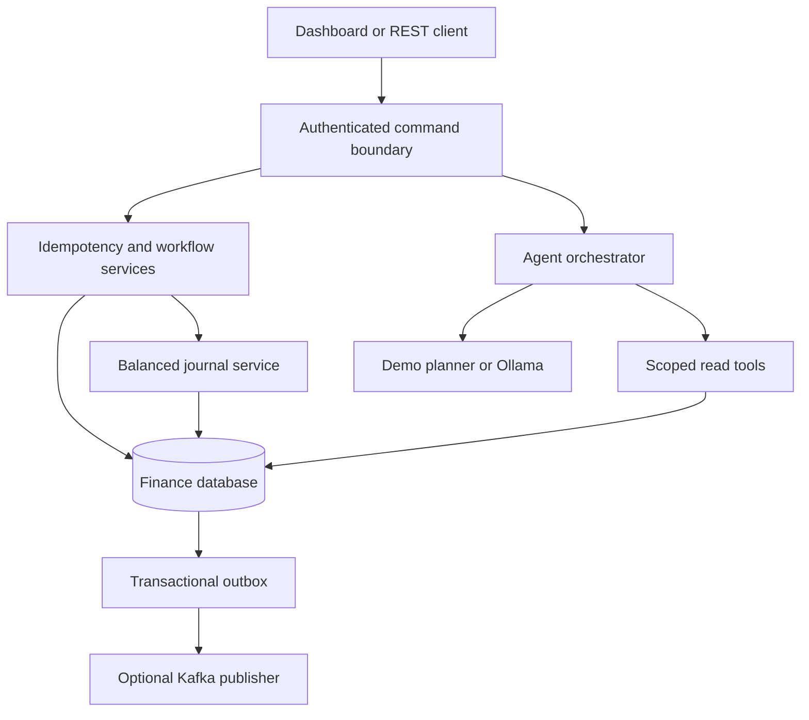

# Architecture

The application is a modular monolith, with one transactional boundary for each
financial command. Controllers validate input and derive actor/roles from Spring
Security. Clients cannot submit an actor or an invoice status in a creation payload.

An approval holds a pessimistic invoice row lock, verifies state, actor separation,
and the configured review limit, then creates one uniquely referenced journal.
All workflow, journal, audit, outbox and idempotency changes commit together.
Settlement locks invoice before bank transaction, verifies exact evidence, and
records the match, paid status and settlement journal in one transaction.

Debit minus credit is the signed account balance. Approval debits EXPENSE and
credits ACCOUNTS_PAYABLE. Recording a matched outgoing bank record debits
ACCOUNTS_PAYABLE and credits CASH. Each journal must balance, across at least
two accounts, in one currency. The journal API has no update or delete operation.

Idempotency is scoped to actor plus key, with a SHA-256 fingerprint covering the
command and JSON request. Concurrent inserts are protected by a database unique
constraint. A losing in-flight request receives 409 and can retry the original key.
Failed transactions retain no partial command, audit event, journal or outbox event.

Agent requests capture an invoice version and persist a run before model calls.
There is no database transaction around the entire model loop. Tools cannot
read another invoice or another currency's balances. Responses record all executed
tool inputs/results and known policy references. A recommendation is a snapshot:
the human command rechecks current state under a lock.

Outbox publication locks a small batch and waits for broker acknowledgement before
marking an event published. A crash after broker acceptance and before DB commit
can redeliver the same event ID. No exactly-once cross-system claim is made.

Collections have bounded page sizes. Dashboard sums filter currency and never add
unlike currencies. Schema indexes cover invoice states, pending events and audit lookups.
